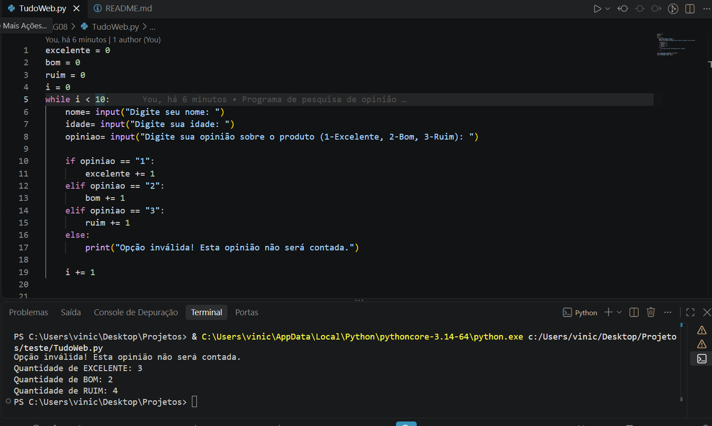

# 📊 Pesquisa de Opinião TudoWeb

---

## 📋 Sobre o Projeto

Este projeto foi desenvolvido durante a **Agenda 08** do curso Técnico em Desenvolvimento de Sistemas. O objetivo é criar um programa em Python que realize uma **pesquisa de satisfação** com **50 clientes** da empresa de marketing **TudoWeb**.

O programa coleta o **nome**, a **idade** e a **opinião** de cada entrevistado sobre o atendimento prestado, classificando as respostas em três categorias:

- **1** → EXCELENTE
- **2** → BOM
- **3** → RUIM

Ao final, o programa exibe a quantidade total de respostas **EXCELENTE** e **RUIM**.

---

## 🎯 Objetivo do Sistema

- Coletar dados de 50 entrevistados (nome, idade e opinião)
- Utilizar **estruturas de repetição** (`while`) para realizar a pesquisa
- Utilizar **estruturas de decisão** (`if`, `elif`) para verificar a opinião
- Contar quantas respostas foram **EXCELENTE** e **RUIM**
- Exibir os resultados finais na tela

---

## 🧮 Regras de Negócio

| Opinião | Código | O que é contado? |
|:---|:---|:---|
| EXCELENTE | `1` | ✅ Conta na variável `excelente` |
| BOM | `2` | ✅ Conta na variável `bom` |
| RUIM | `3` | ✅ Conta na variável `ruim` |

**No final, o programa mostra:**
- Quantidade de respostas **EXCELENTE**
- Quantidade de respostas **BOM**
- Quantidade de respostas **RUIM**

---

## 🛠️ Tecnologias Utilizadas

  
  
  
  

- **Linguagem:** Python 3.14
- **Ambiente:** VS Code
- **Controle de Versão:** Git e GitHub
- **Bibliotecas:** Nenhuma (apenas recursos nativos do Python)

## 📸 Print do Programa

### Exemplo 1: Execução da Pesquisa
